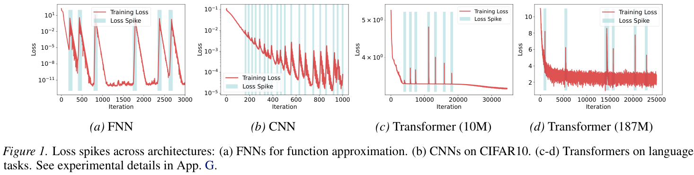
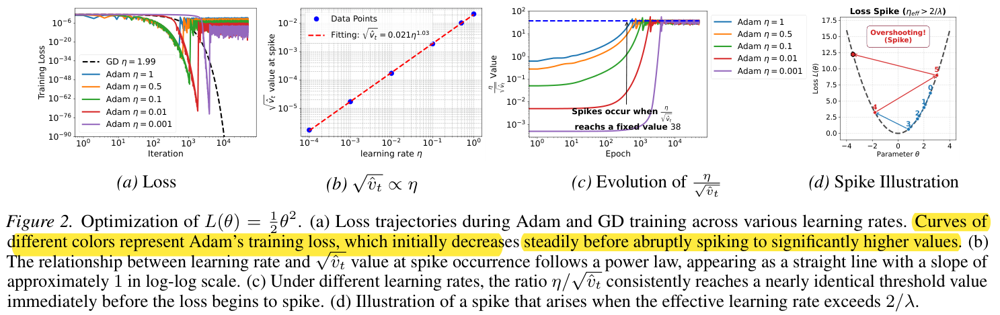
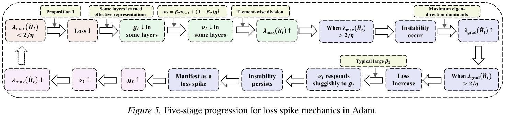

1. [10] Adaptive Preconditioners Trigger Loss Spikes in Adam

---

## 1. [10] Adaptive Preconditioners Trigger Loss Spikes in Adam

### understanding Adam
Let's first understand the Adam optimizer:

Different parameters can have very different gradients. If we used the same learning rate for all parameters, it could result in updates that vary wildly in scale—for example, from 100 to 0.001—depending on the gradient. To address this, Adam applies a per-parameter scaling factor, specifically dividing by `sqrt(v_t)`, where `v_t` is a running average of the squared gradients.

This normalization ensures that parameter updates are on a more consistent scale, regardless of the absolute size of the gradients.

Moreover, because `v_t` incorporates historical gradient information, Adam helps smooth out updates. Sudden, large changes in the gradient don't immediately produce large updates—they are averaged into the running estimate, making the optimization process more stable.



Adam not only determines the update direction based on the current gradient, but also scales each parameter's update using the moving average of squared gradients from history. If the historical information is updated too slowly, the step size can become too aggressive and the loss may suddenly spike.

---

First, recall Adam's second-moment formula:

```
v_t = β₂ * v_{t-1} + (1 - β₂) * (g_t)²
```

Where:

- `g_t`: gradient at current step
- `(g_t)²`: elementwise square of the current gradient
- `v_{t-1}`: exponentially weighted average of previous squared gradients
- `β₂`: retention rate of the history; closer to 1 reacts more slowly, relies more on the history

Ignoring bias correction and the very small epsilon, Adam's parameter update can be written as:

```
Δθ_t ≈ -η * g_t / sqrt(v_t)
```

Therefore, when the gradient `g_t` is unchanged, a smaller `v_t` leads to a larger update in parameters. But note: the update size also depends on the gradient itself; you can't just look at `v_t`.



Let's break these dynamics down step by step:



### (1) Training loss decreases normally

Training loss decreases as expected. Parameter updates make the model more accurate on the training set.

For example, if the gradient for some parameter is `g_t = 2`, and Adam's running estimate of squared gradient is `v_t = 4`:

```
|Δθ_t| ≈ η * 2 / sqrt(4) = η
```

The update step is reasonable, and the model steadily progresses to lower loss.

No unusual behavior occurs here: gradients provide the update signals, Adam’s `v_t` scales the updates, and training proceeds as it should.

---

### (2) Adam's second-moment estimate `v_t` decays, increasing effective update scaling

Now, `v_t` begins to decrease, so the same gradient leads to a larger update. Why would this happen?

Recall:

```
v_t = [β₂ * v_{t-1}] + [(1 - β₂) * (g_t)²]
```

If the square of the current gradient is smaller than the previous estimate (`(g_t)² < v_{t-1}`), the new `v_t` will be smaller than before.

For example, let `β₂ = 0.99`, `v_{t-1} = 4`, and `g_t = 1`:

```
v_t = 0.99 * 4 + 0.01 * 1 = 3.97
```

So `v_t` goes from 4 to 3.97.

What does this mean? Assume the gradient stays at 1:
- If `v_t = 4`, update magnitude is about `η / 2`
- If `v_t = 1`, update magnitude is about `η`

As `v_t` drops, Adam’s scaling factor `1 / sqrt(v_t)` increases.

**Note:** Lower `v_t` is not always bad; it makes sense if gradients are genuinely smaller in the long run. The problem arises if `v_t` lags and doesn't reflect the present situation.

---

### (3) The effective curvature crosses a stability threshold, causing unstable updates and a sharp loss increase

Effective curvature exceeds a stability threshold, updates become unstable, and the loss jumps up. Why does this happen?

**A Simple Bowl Analogy**

Imagine the loss surface as a bowl:
- Shallow bowl: moving parameters slightly doesn’t change loss much.
- Steep bowl: moving parameters too far can send the loss dramatically higher.

For a basic quadratic function, the stability condition for gradient descent is:

```
η * λ_max(H) < 2
```

Where:
- `H`: Hessian (matrix of 2nd derivatives) of the loss
- `λ_max(H)`: largest eigenvalue (steepest curvature direction)

If `η` is too big for the curvature, parameters may overshoot the minimum, causing the loss to rise or oscillate.

Adam scales gradients by `v_t`. If `v_t` for a parameter gets small, effective update size grows.

So, even if the loss surface stiffness doesn't change, Adam’s preconditioner can make optimization unstable in some directions. The referenced paper analyzes this with the preconditioned effective curvature and defines the stability boundary as `2/η`.

**In summary:**
1. Updates were previously stable.
2. `v_t` decreases, update scale increases in some directions.
3. The same gradient now produces much bigger parameter changes.
4. Parameters overshoot, loss suddenly spikes.

Crossing the curvature threshold simply means risk of instability (loss need not instantly explode), and depends on the direction of the gradient.

---

### (4) Gradients grow, but `v_t` initially remains dominated by its history and continues to decay

After the loss rises, gradients become larger, but `v_t` may not immediately reflect this and can keep decreasing. Why?

The key: `v_t` is an exponential moving average of past squared gradients, not just the current value.

Suppose:

- `β₂ = 0.99`
- Before this step: `v_{t-1} = 4`, `(g_t)² = 2`

Then:

```
v_t = 0.99 * 4 + 0.01 * 2 = 3.98
```

So although the current squared gradient is 2, as it's less than 4, `v_t` still drops.

Consider:

| Current (g_t)² | v_{t-1} | New v_t | Change      |
|----------------|---------|---------|-------------|
|       1        |    4    |  3.97   | Decreases   |
|       2        |    4    |  3.98   | Decreases   |
|       4        |    4    |  4.00   | No change   |
|      10        |    4    |  4.06   | Increases   |

So `v_t` decreases even as `(g_t)²` rises from 1 to 2, as long as it hasn't exceeded the historical estimate.

With `β₂ = 0.99`, the current value only shifts the estimate by 1% per step — so `v_t` changes very slowly.

This causes a dangerous feedback process:
- Updates become too aggressive, and loss increases.
- The increased loss results in larger gradients.
- But `v_t` lags behind, or may even keep decreasing.
- The update scaling factor keeps growing, amplifying instability risk.

This "lag" between Adam’s second-moment estimate and the current squared gradient is a key mechanism discussed in the paper.

---

### (5) The squared gradients eventually drive `v_t` upward, reducing effective curvature and allowing the loss to recover

Eventually, the squared gradients get big enough that `v_t` starts to increase, updates become suppressed, and the loss can recover.

Recall:

```
v_t - v_{t-1} = (1 - β₂) * [ (g_t)² - v_{t-1} ]
```

Thus, directly:
- If `(g_t)² < v_{t-1}`: `v_t` decreases
- If `(g_t)² = v_{t-1}`: `v_t` unchanged
- If `(g_t)² > v_{t-1}`: `v_t` increases

Suppose `v_{t-1} = 4`, now `(g_t)² = 100`:

```
v_t = 0.99 * 4 + 0.01 * 100 = 4.96
```

Now, `v_t` finally increases.

When `v_t` rises, the update scaling `1 / sqrt(v_t)` shrinks. If previous instability was mainly caused by excessive scaling, this can reduce effective curvature, restore stable training, and the loss may decrease again.

However, if parameters already drifted too far (due to extreme parameter change, trajectory change, or other issues), simply raising `v_t` might not be enough to rescue the run. The paper admits that sometimes spikes recover, and sometimes lead to collapse, with no complete explanation.

---

### To summarize the five-stage process:

#### 1. Normal training

Gradients and updates are reasonable, and the loss steadily decreases.

#### 2. `v_t` decays

Current squared gradient is less than its historical estimate, so the update scaling factor grows for some parameters.

#### 3. Spike triggered

Preconditioner scaling no longer matches the local curvature, the optimizer overshoots, and the loss jumps.

#### 4. Mismatch persists

Gradients get bigger, but squared gradients are still not catching up with history, so `v_t` may keep dropping.

#### 5. Possible recovery

Once squared gradients overtake history, `v_t` rises, update scaling shrinks, and training may restabilize.

---

**The key takeaway is not just "bigger gradients give higher loss," but:**

Adam’s `v_t` responds slowly to changes in squared gradients, so even as the loss worsens, it can keep suggesting larger and larger updates due to this lag. This delay is what lets a routine optimization fluctuation escalate into a full-blown loss spike.
